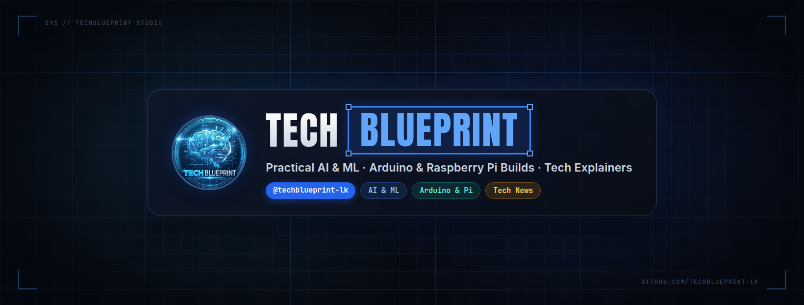

  

# Hi, welcome to TechBlueprint (`@techblueprint-lab`) 👋

This is where I build and share **practical tech projects from scratch** — keeping the code clean, runnable, and easy to understand.

Right now, I'm focused mainly on **Machine Learning with Python** — taking real datasets, breaking down how models actually work, and showing practical lessons you can use in real projects (not just textbook theory). Next up, I'll also be expanding into **Arduino & Raspberry Pi hardware builds**, along with **one bigger end-to-end Capstone project every month**.

Everything here is free and open-source — feel free to clone the code, experiment with it, or use it to build your own portfolio.

---

## Repositories

| Repository | Focus | What's Inside |
| :--- | :--- | :--- |
| [**`ml-blueprints`**](https://github.com/techblueprint-lab/ml-blueprints) | 🧠 **Machine Learning *(Main Focus)*** | Daily Python ML projects using real datasets — Classification, Clustering, NLP, Anomaly Detection, ML Traps & Regression |
| [**`arduino-blueprints`**](https://github.com/techblueprint-lab/arduino-blueprints) | ⚡ **Arduino & ESP32 *(Coming Next)*** | Practical sensor & IoT prototypes with `.ino` code, parts lists, and simple wiring diagrams |
| [**`raspberry-pi-blueprints`**](https://github.com/techblueprint-lab/raspberry-pi-blueprints) | 🍓 **Raspberry Pi *(Coming Next)*** | Edge AI builds, mini-servers, GPIO automation & dev-board guides |
| [**`monthly-capstones`**](https://github.com/techblueprint-lab/monthly-capstones) | 🏆 **Monthly Capstones** | Bigger end-to-end projects built once a month combining ML pipelines, apps & hardware |

---

### Follow Along
- Follow **`@techblueprint-lab`** on **YouTube, Facebook, TikTok & LinkedIn** for short visual walkthroughs of every project here.
- ⭐ Star any repo if you find the code useful!
